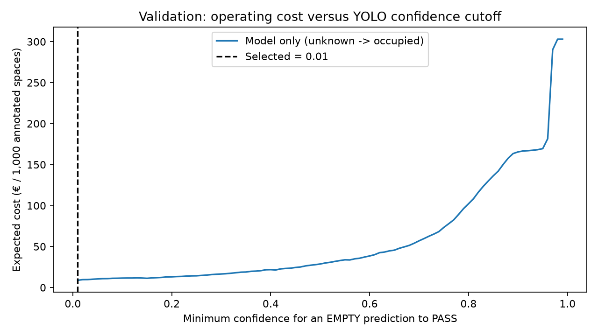

# Assignment 2 Report
- **Name**: Antonio Cabral de las Casas
- **Student ID**: 19360
- **Email**: acabral.ieu2022@student.ie.edu
- **Group**: BBADBA 5A

## Business problem, and the cost of being wrong
For this assignment I wanted to do something related to the rent a car industry. My idea was to use computer vision to detect empty and occupied parking spaces to help employees find available spots without having to check them manually.

The model has three possible decisions: **PASS** (free), **FAIL** (occupied), and **REVIEW** (needs human verification).

I considered *occupied* as the positive class. A false positive means marking a free space as occupied while a false negative means recommending a space that is actually occupied. I believe false negatives are more expensive because they can interrupt the parking process, so assuming a labour cost of €30/hour, I estimated €1 for a false positive (two minutes wasted), €5 for a false negative (ten minutes) and €0.50 for a human review (one minute). Correct decisions have no additional cost.

These are estimated costs not actual company data but they help explain why I care more about some mistakes than others.

## Dataset
I used the public **Parking Space** dataset from Roboflow Universe:

**Workspace:** `muhammad-syihab-bdynf`
**Project:** `parking-space-ipm1b`
**Version:** `4`
**Link:** https://universe.roboflow.com/muhammad-syihab-bdynf/parking-space-ipm1b/dataset/4

It contains images of parking areas annotated with two classes: `empty` and `occupied`. I chose it because it directly matches my business problem. The objective is not just to detect cars but to identify parking spaces and their status.

## What the dataset's composition implies
The original dataset had 7,801 images, however, I found some annotation files mixing bounding boxes and segmentation polygons which caused Ultralytics to exclude 411 images.

After these exclusions, the dataset contained:

| | Train | Validation | Test |
|---|---:|---:|---:|
| Images | 6,657 | 525 | 208 |
| Empty | 44,159 | 3,556 | 1,974 |
| Occupied | 90,708 | 8,179 | 4,361 |

Something interesting is that around **70% of parking spaces are occupied** across all three splits which matters when calculating costs since predicting everything as occupied would already avoid the most expensive type of mistake.

I also checked object sizes: the median bounding box area was around **1.5–1.7% of the image** although some spaces were much smaller, for example, the smallest 10% of empty spaces in test occupied at most 0.22% of the image, compared with 0.50% in training.

Another issue I found was that **32 video sources appeared across different splits**, which means the model could be evaluated on frames very similar to those it saw during training potentially making the results look better than they would on a completely new parking lot.

## Finetuning and baselines
I fine-tuned **YOLO11n** mainly because it is lightweight and seemed like a good option for a system that could process parking camera images.

I trained it in Google Colab using a Tesla T4 GPU starting from pretrained YOLO11n weights with **30 epochs, image size 640, batch size 16 and seed 42**.

I then compared it against a pretrained COCO model without fine-tuning and a baseline that predicts nothing. For COCO I treated car, bus and truck detections as occupied spaces although this is not a perfect comparison because COCO cannot identify empty parking spaces.

| Model | Test mAP50 | Test mAP50–95 |
|---|---:|---:|
| **Fine-tuned YOLO11n** | **97.19%** | **84.87%** |
| COCO zero-shot | 23.73% | 5.27% |
| Predict nothing | 0% | 0% |

The improvement was much bigger than I expected showing how important it is to train the model specifically for the problem rather than relying on general vehicle detection.

## Per-class evaluation and failure modes
Looking at the individual classes gives a better picture of the results.
| Test metric | Empty | Occupied |
|---|---:|---:|
| Precision | 87.22% | 85.43% |
| Recall | 95.74% | 99.36% |
| AP50 | 96.19% | 98.19% |

Precision and recall use confidence 0.25 and IoU 0.50.

The detection confusion matrix was:
| Actual / Predicted | Empty | Occupied | Missed |
|---|---:|---:|---:|
| Empty | 1,872 | 75 | 27 |
| Occupied | 11 | 4,329 | 21 |
| Background / unmatched | 284 | 668 | x |

The model is particularly good at finding occupied space which is useful considering our higher cost for recommending an unavailable spot.

However, it still makes mistakes especially when identifying empty spaces and were also extra detections that did not match the annotations. These are important because in a real parking facility detecting something that is not a parking space could also create problems.

## Cost matrix and operating point
I calculated the operating cost using:
**Cost = FP x €1 + FN x €5 + Reviews x €0.50**

I used the validation occupancy rate of **69.70%** as my base rate and tested confidence thresholds between 0.01 and 0.99. I compared two approaches: letting the model decide everything or allowing it to send uncertain predictions to human review. The lowest estimated validation cost was obtained with thresholds of **0.01 for both classes**.

| Approach | Validation €/1,000 | Test €/1,000 |
|---|---:|---:|
| Model only | 8.86 | **21.31** |
| Hybrid | **8.05** | 21.78 |

I selected the thresholds using validation and kept them unchanged for test. What surprised me the most is that the hybrid approach was slightly better in validation but worse in test. So adding human review does not necessarily reduce costs.

I also tested different assumptions like 90% occupancy and a €5 false-negative cost, the best threshold for approving an empty space increased to 0.44 showing that the best threshold depends on the actual business conditions.

I would not consider 0.01 a reliable production threshold yet, especially because it was the lowest value tested.

## What a person still has to check

For human review I simulated which predictions would need to be checked. A prediction is sent for review when its confidence is below the corresponding threshold or when no prediction can be matched to an annotated parking space.

With the selected thresholds, 37 out of 11735 validation spaces required review or **0.32%**.

Assuming 500 parking space decisions per day, this would mean around **1.6 reviews daily** taking approximately 1.6 minutes in total. That represents just **0.0047 full-time employees** assuming an eight-hour shift and 70% productive time. In practice, I think an existing employee could easily handle this rather than hiring someone specifically for it.

I also compared the alternatives using validation data:
| Strategy | Cost per 1,000 spaces |
|---|---:|
| Assume all spaces are free | €3,484.87 |
| Assume all spaces are occupied | €303.03 |
| Human reviews everything | €500.00 |
| Model only | €8.86 |
| **Hybrid** | **€8.05** |

However on test, the hybrid system produced 78 false positives, 11 false negatives and 10 reviews giving a total estimated cost of **€21.78 per 1,000 spaces**.

So while the results look promising I would not say we have proven that the hybrid system is always the best option.

## Limitations & next steps
One of the main limitations I noticed while building the dashboard is that detecting empty and occupied spaces is not enough to manage a real parking lot. In our evaluation, we already know where the annotated spaces are but with a completely new image, YOLO doesn't know which exact parking spot each prediction belongs to.

If I wanted to implement this in a real car rental company I would first create a map of the parking spaces at each location and connect YOLO's predictions to those specific spots. This way employees could know exactly where to park instead of just seeing detected spaces on a camera image.

There are also a few things I would improve. We had 7191 unmatched predictions in validation and 3723 in test that were not included in our cost calculations. Some annotations were inconsistent and several videos appeared across different splits which could make our results look better than they actually are. Also, human reviews were only simulated assuming they always took one minute and were correct.

Overall, I'm quite happy with how the model performed but I think the next step would be testing it in a real parking facility with new camera images and actual employees before considering it a reliable solution.

## Generative AI use disclosure

I used AI to help with coding, debugging, building the Gradio dashboard and format the report. The reported metrics come from the executed code while the operational costs are hypothetical assumptions used for the business analysis.